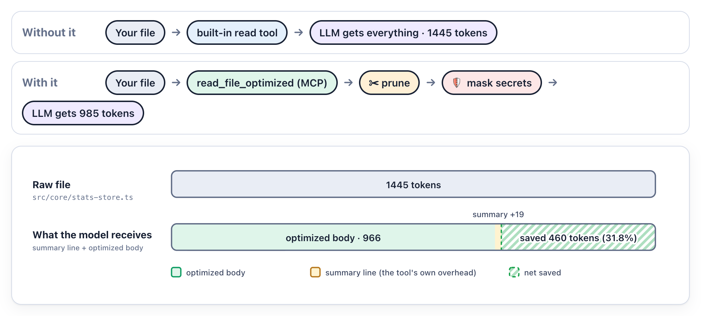
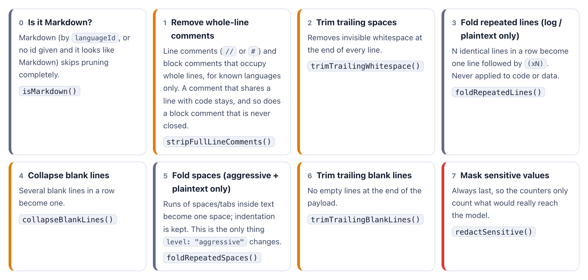
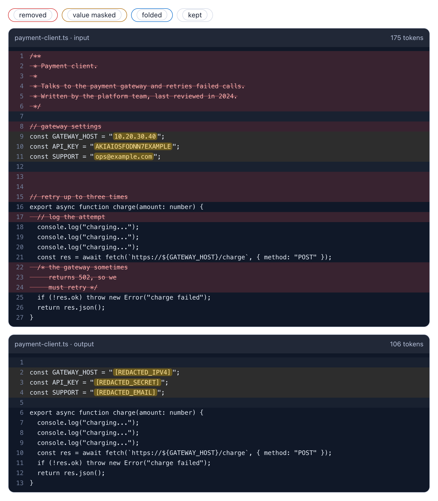
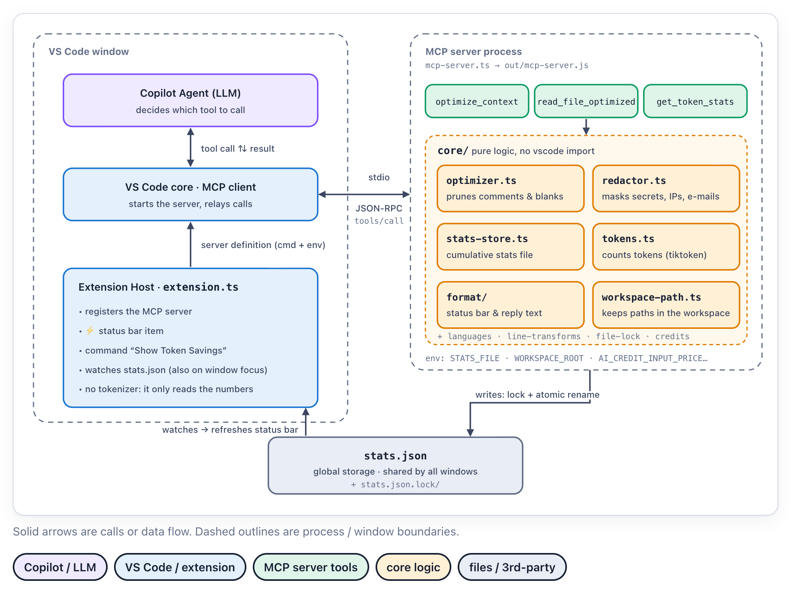
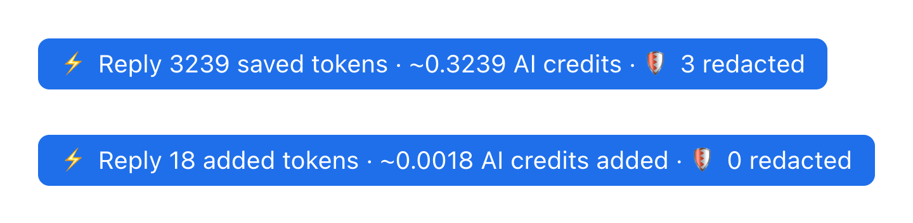
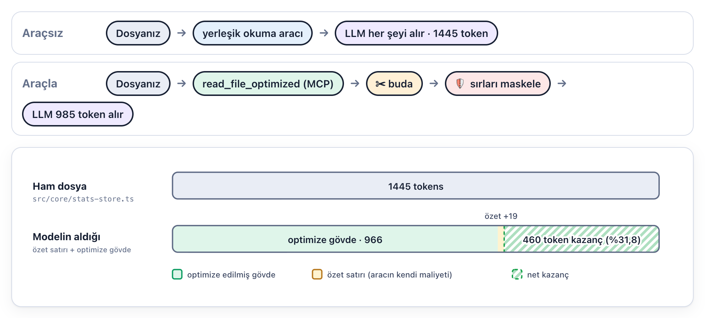
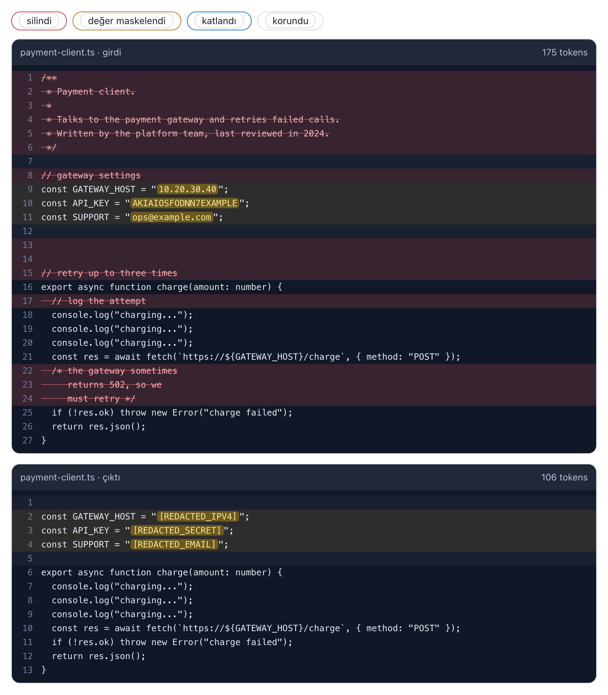
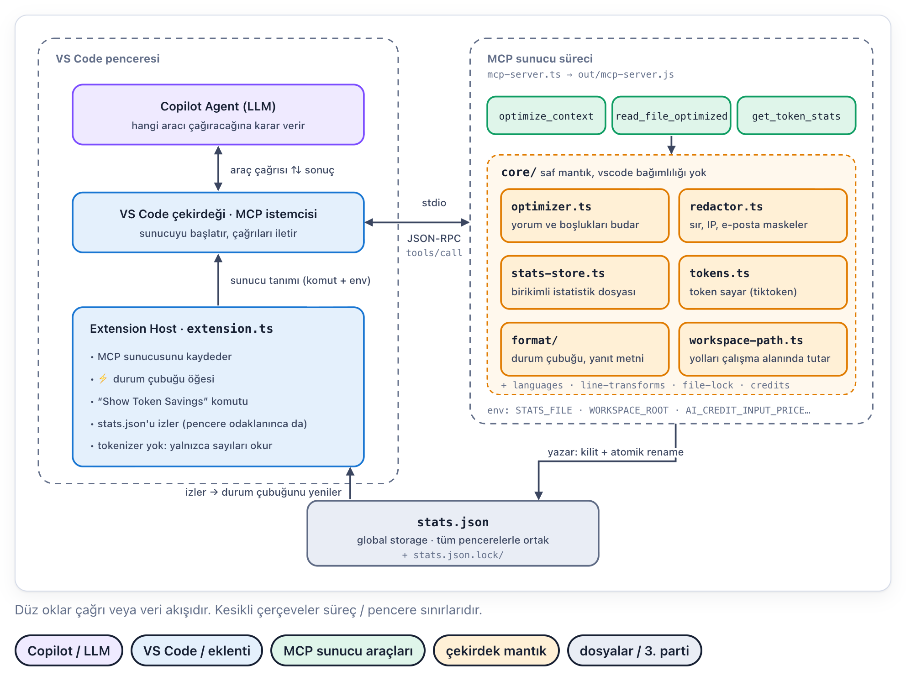

<h1 align="center">Enterprise AI Token Optimizer</h1>

<p align="center">
  <b>Prune · Redact · Measure</b><br>
  Shrink everything Copilot's agent reads — <i>before</i> it reaches the model.
</p>

<p align="center">
  <a href="https://marketplace.visualstudio.com/items?itemName=abdullahsuhaisik.token-saver-mcp"></a>
  
  
  
  
</p>

<p align="center">
  <a href="#english"><b>English</b></a> &nbsp;·&nbsp; <a href="#turkce"><b>Türkçe</b></a> &nbsp;·&nbsp; <a href="#italiano"><b>Italiano</b></a>
</p>

---

<a id="english"></a>

## English

A VS Code extension + MCP (Model Context Protocol) server that prunes and compresses text and file content going into Copilot/agent tools **before it reaches the LLM**. It strips unnecessary comments, whitespace and repeated lines to cut token usage, masks sensitive values, and reports the savings in real time in the status bar.

### 💡 Why

Every character Copilot's agent reads costs tokens. Comments, blank lines, repeated log lines — and even secrets — are paid for and sent to the model. This extension sits between the agent and your files:



*Example: one source file read through `read_file_optimized` (tokens counted with tiktoken `o200k_base`; the one-line summary the tool prepends is included).*

### 🚀 Quick start

1. **Install** the extension from the [VS Code Marketplace](https://marketplace.visualstudio.com/items?itemName=abdullahsuhaisik.token-saver-mcp), or run:

   ```bash
   code --install-extension abdullahsuhaisik.token-saver-mcp
   ```

2. **Open Copilot Chat in Agent mode.** The MCP server registers itself, so `optimize_context`, `read_file_optimized` and `get_token_stats` are available with no configuration. The ⚡ savings indicator appears in the status bar.
3. **Set up Copilot for your project.** [Add the project instructions](#copilot-setup-en) once in each project so Copilot can prefer the optimizer's tools.

<a id="copilot-setup-en"></a>

### 🤖 Make Copilot use the tools

> **📍 One-time setup per project**
>
> 📂 Open your project in VS Code → 💻 **Terminal → New Terminal** → 📋 Copy and run the command below.
>
> Make sure the terminal is in **your project's root**, not the extension's installation folder.

The command creates `.github/copilot-instructions.md` or **appends** to the existing file; it does not overwrite your instructions. Run it only once. If the file already contains instructions for these tools, update those instructions instead of adding duplicates.

**macOS / Linux / Git Bash**

```bash
mkdir -p .github && cat >> .github/copilot-instructions.md <<'EOF'

# Copilot Instructions — AI Token Optimizer

- When reading the contents of a workspace file, prefer the `read_file_optimized`
  MCP tool (from the "AI Token Optimizer" server) over the built-in file-read
  tool, so token savings are tracked.
- When optimizing or summarizing a text/code payload that is not read from a
  file, prefer the `optimize_context` MCP tool.
- After a batch of optimizations, you may call `get_token_stats` to report
  cumulative savings if the user asks for a summary.
EOF
```

<details>
<summary><b>🪟 Windows (PowerShell) — click to expand</b></summary>

```powershell
New-Item -ItemType Directory -Force .github | Out-Null
@'

# Copilot Instructions — AI Token Optimizer

- When reading the contents of a workspace file, prefer the `read_file_optimized`
  MCP tool (from the "AI Token Optimizer" server) over the built-in file-read
  tool, so token savings are tracked.
- When optimizing or summarizing a text/code payload that is not read from a
  file, prefer the `optimize_context` MCP tool.
- After a batch of optimizations, you may call `get_token_stats` to report
  cumulative savings if the user asks for a summary.
'@ | Add-Content -Path .github/copilot-instructions.md -Encoding utf8
```

</details>

**✅ Check it:** Open `.github/copilot-instructions.md` in your project and confirm the instructions are there. In Copilot Chat's **Agent** mode, enable the AI Token Optimizer tools in **Tools**, then ask Copilot to use `read_file_optimized` on a project file. Look for its tool call in the chat.

Copilot reads the project instruction file when workspace instructions are enabled, but the model decides which tool to call. You can mention `#read_file_optimized` explicitly; for stricter routing, disable the built-in file-read tool from the **Tools** picker and re-enable it when needed.

### ✨ See it work

`optimize()` chains eight small, pure stages; each one takes lines in and gives lines out. Nothing is guessed: unknown content is never treated as code.



A real run on a TypeScript file (27 lines in, 13 lines out):



**175 → 106 tokens (−39.4 %)** · 693 → 404 characters · 3 values masked (1 secret, 1 IPv4, 1 e-mail). The three `console.log` lines stay: this is code, so repeated lines are never folded. With `languageId: "log"` the same engine folds repeated lines (`line  (x12)`) in logs and terminal output.

### 🧰 Features

| | Feature | What it does |
|:-:|---|---|
| ✂️ | **Prunes the noise** | Removes comments that occupy whole lines (using the syntax of known languages), trailing spaces and runs of blank lines. Markdown is preserved and unknown content is never guessed to be code. |
| 🔁 | **Folds repeated lines** | `line  (x3)` — only for the `log` and `plaintext` languages, never for code or data. |
| 🛡️ | **Masks sensitive values** | Secrets and API keys, passwords, private keys, IPv4/IPv6 and MAC addresses and e-mails become `[REDACTED_SECRET]`, `[REDACTED_IPV4]`, … before they reach the LLM. The counts appear in the tool output, the status bar and the savings report. |
| 🔒 | **Reads files safely** | `read_file_optimized` rejects requests that escape the workspace root (path traversal), including through symlinks that lead outside it. |
| 📏 | **Measures honestly** | Tokens are counted with tiktoken. The complete textual reply (summary line plus optimized content) is measured separately from payload-only savings, so growth is reported as well as savings. |
| 📊 | **Shows it live** | The status bar shows the cumulative net token and credit change for measured complete replies, summary included. `AI Token Optimizer: Show Token Savings` opens a detailed report that separates payload savings from net savings. |
| 💰 | **Estimates AI Credits** | Converts saved input tokens into AI Credits with your model's price (`aiTokenOptimizer.aiCreditInputPricePerMillionUsd`, default `$1/1M tokens`). |
| 🔌 | **Works with any MCP client** | Three tools over stdio — `optimize_context`, `read_file_optimized` and `get_token_stats` — in VS Code and in Claude Code, Claude Desktop, Cursor and other MCP clients. |

Two optimization levels: `conservative` (the default) and `aggressive`, which additionally folds repeated spaces — only for explicitly selected `plaintext`, so the spacing of code and Markdown is always preserved.

### 🧩 How it works



1. When the extension activates, it starts `out/mcp-server.js` as a separate process — using VS Code's bundled Node runtime, so no `node` is needed on your `PATH` — and passes it the `STATS_FILE` and `WORKSPACE_ROOT` environment variables.
2. When the agent calls a tool, the server runs the text through `optimize()` (prune, then mask) and returns the result.
3. The savings are written to a shared stats file (lock + atomic rename).
4. The extension watches that file and refreshes the status bar. Only the MCP server process loads the tokenizer (`tokens.ts`); the extension host just reads the numbers the server stored.

### 📊 Status bar and report



The status bar item shows the cumulative net change for measured complete replies — summary line included — and how many values were masked. When a reply ends up longer than the original (the summary costs more than it saved), it says `added` instead of `saved`. Click the item, or run **AI Token Optimizer: Show Token Savings** from the Command Palette, for the full report (example values):

```text
=== AI Token Optimizer — Cumulative Savings ===
Optimization calls : 22
Payload raw tokens : 13567
Optimized payload  : 9921
Payload net change : 3646 saved tokens (26.9%)
Payload credits    : ~0.3646 AI credits (estimated)
Complete replies   : 22
Measured input     : 13567 tokens
Returned text      : 10328 tokens (summary included)
Net reply change   : 3239 saved tokens
Net reply credits  : ~0.3239 AI credits (estimated)
Estimate rate      : $1 per 1M input tokens
Estimate only; actual Copilot usage depends on model pricing and cached tokens.
Redacted (total)   : 3
  Secrets / keys   : 1
  IPv4 addresses   : 1
  IPv6 addresses   : 0
  MAC addresses    : 0
  E-mail addresses : 1
```

### 🔌 Use with Claude Code, Claude Desktop, Cursor and other MCP clients

<details>
<summary><b>Show the setup instructions</b></summary>

The MCP server uses the standard local `stdio` transport, so it can also run from MCP clients other than VS Code. No VS Code extension is needed in those clients.

1. Clone this repository and build the server:

   ```bash
   git clone https://github.com/abdullahsuhaisk/copilot-token-optimizer.git
   cd copilot-token-optimizer
   npm install
   npm run compile
   ```

   Use Node.js 20 or later. Keep the clone and its `node_modules` directory available; the client starts `out/mcp-server.js` directly.

2. Set the server script path to the absolute path of this clone, and set `WORKSPACE_ROOT` to the project whose files the AI should read. `read_file_optimized` is restricted to that workspace root. `STATS_FILE` is optional; configure it to a writable file path if you also want to persist and view savings across clients.

#### Claude Code

From the project directory you want Claude Code to work in, run this command after replacing both example paths:

```bash
claude mcp add --transport stdio --scope local \
  --env "WORKSPACE_ROOT=/absolute/path/to/your/project" \
  --env "STATS_FILE=/absolute/path/to/your/project/.ai-token-optimizer-stats.json" \
  ai-token-optimizer -- node /absolute/path/to/copilot-token-optimizer/out/mcp-server.js
```

#### Claude Desktop and Cursor

Add the following entry to the `mcpServers` object in the client's MCP configuration. Replace the example paths with absolute paths. For Claude Desktop, open **Settings → Developer → Edit Config**; for Cursor, add it to `.cursor/mcp.json` in your project. If the file already has an `mcpServers` object, add only the `ai-token-optimizer` entry rather than replacing the existing servers.

```json
{
  "mcpServers": {
    "ai-token-optimizer": {
      "command": "node",
      "args": ["/absolute/path/to/copilot-token-optimizer/out/mcp-server.js"],
      "env": {
        "WORKSPACE_ROOT": "/absolute/path/to/your/project",
        "STATS_FILE": "/absolute/path/to/your/project/.ai-token-optimizer-stats.json"
      }
    }
  }
}
```

Restart or reload the client after saving its configuration. The three tools (`optimize_context`, `read_file_optimized`, and `get_token_stats`) will then be available. Omit `STATS_FILE` if you do not need persistent savings statistics.

</details>

### 🎓 Learn more, visually

| | Resource | What you get |
|:-:|---|---|
| 🧭 | **[Visual guide](visual-guide/index.html)** | An interactive walkthrough in English and Turkish: architecture, one tool call step by step, the optimizer, redaction and measuring. It is a single self-contained file; clone the repository and open it in your browser. |
| 📖 | **[The same story on GitHub](visual-guide/README.md)** | Mermaid diagrams rendered by GitHub, in English and Turkish. |
| 🎞️ | **[Slides](docs/slides.html)** | A short slide deck (Turkish). |

### ⚠️ Known limitations

- Optimization only happens at the MCP tool-output boundary; VS Code currently has no API to transparently rewrite Copilot's own prompt, so the model's direct input cannot be altered.
- AI Credits are an estimate based on uncached input-token price, not Copilot billing data. Set `aiTokenOptimizer.aiCreditInputPricePerMillionUsd` to the input price for your model; actual usage can differ due to model choice and cached tokens.
- Stats are stored in `stats.json` inside the extension's global storage directory, shared by all VS Code windows, and show the cumulative total across projects. Complete-reply measurements start with calls from version 0.0.8; older records remain in payload-only totals because they did not store the reply summary. When older calls exist, the status bar shows all-time **Payload** totals separately from measured **Reply** totals. These totals overlap and must not be added; exact net reply savings cannot be reconstructed for older calls.
- Repeated-line folding (`line  (x3)`) only applies when `languageId` is `log` or `plaintext`. `optimize_context` leaves other text unfolded, so pass `languageId: "log"` for logs and terminal output.
- Each optimized reply starts with a one-line summary (about 19 tokens, more when values were masked), and it is left out when nothing changed. A file that shrinks by less than the summary costs ends with a net increase, which the status bar shows as "added".

### 🛠️ Contributing

<details>
<summary><b>Requirements, project layout, setup, scripts and releasing</b></summary>

#### Requirements

- Node.js `>= 20`
- VS Code `^1.101.0`
- npm

#### Project layout

```
src/
  extension.ts          -> VS Code extension entry point (status bar, command, MCP definition)
  mcp-server.ts         -> Entry point of the standalone MCP server process (stdio transport)
  mcp/                  -> The MCP server: configuration, tool registration and the three tools
  core/                 -> Pure logic, independent of vscode and MCP
    optimizer.ts        -> Pruning pipeline (comments, blank and repeated lines)
    languages.ts        -> Comment syntax per language; file extension -> languageId
    line-transforms.ts  -> Pure line-level transforms used by the optimizer
    redactor.ts         -> Masks secrets, IP/MAC addresses and e-mails
    tokens.ts           -> Token counting (tiktoken) and savings measurement
    credits.ts          -> AI Credit estimate and the default input price
    stats-store.ts      -> Cumulative statistics in the shared stats file
    file-lock.ts        -> Cross-process lock for the shared stats file
    workspace-path.ts   -> Confines file paths to the workspace root (symlink-safe)
    format/             -> Text for the status bar, the savings report and tool replies
test/                   -> Vitest unit tests
```

#### Setup

```bash
git clone https://github.com/abdullahsuhaisk/copilot-token-optimizer.git
cd copilot-token-optimizer
npm install
```

#### Running locally

1. **Build**

   ```bash
   npm run compile
   ```

   To rebuild automatically on changes during development:

   ```bash
   npm run watch
   ```

   (This can also be run in the background via the `npm: watch` task defined in `tasks.json`.)

2. **Run the extension in the Extension Development Host**

   - Open the project in VS Code.
   - Press `F5` (or select "Run Extension" from the Run and Debug panel).
   - A new VS Code window (Extension Development Host) opens with the extension loaded.
   - You should see the `$(zap)` savings indicator in the bottom-right status bar.
   - Run **"AI Token Optimizer: Show Token Savings"** from the command palette (`Cmd+Shift+P`) to see the detailed savings report.

3. **Using the MCP server from an agent**

   Once active, the extension automatically registers the MCP server with VS Code's `mcpServerDefinitionProviders` mechanism; `optimize_context`, `read_file_optimized`, and `get_token_stats` become available in Copilot Chat/agent mode with no extra configuration.

4. **Running tests**

   ```bash
   npm test
   ```

   To run in watch mode during development:

   ```bash
   npm run test:watch
   ```

5. **Type-check and lint**

   ```bash
   npm run typecheck
   npm run lint
   ```

#### Available scripts

| Command               | Description                                       |
| --------------------- | -------------------------------------------------- |
| `npm run compile`      | Compiles TypeScript sources into `out/`.           |
| `npm run watch`        | Continuously rebuilds on file changes.             |
| `npm run clean`        | Deletes `out/` (runs before packaging).            |
| `npm run typecheck`    | Type-checks `src` and `test`.                      |
| `npm run lint`         | Runs ESLint on `src` and `test` (warnings fail).   |
| `npm test`             | Runs the Vitest unit tests once.                   |
| `npm run test:watch`   | Runs Vitest in watch mode.                         |
| `npm run pretest`      | Compile + type-check + lint (runs before tests).   |
| `npm run package`      | Builds the `.vsix` package (`vsce package`).       |
| `npm run publish:vsce` | Runs the tests, then publishes (`vsce publish`).   |

Pushing a `vX.Y.Z` tag that matches `package.json` publishes a release through GitHub Actions (`.github/workflows/release.yml`): the code is tested and published with Marketplace Trusted Publishing, so no token is stored. `package` and `publish:vsce` need `vsce` on your `PATH` (`npm install -g @vscode/vsce`).

</details>

### 📄 License

MIT

---

<a id="turkce"></a>

## Türkçe

VS Code eklentisi + MCP (Model Context Protocol) sunucusu olarak çalışan, Copilot/agent araçlarına giden metin ve dosya içeriklerini **LLM'e ulaşmadan önce** budayıp sıkıştıran bir context yöneticisi. Gereksiz yorumları, boşlukları ve tekrar eden satırları temizleyerek token tüketimini azaltır, hassas değerleri maskeler ve kazanımları gerçek zamanlı olarak durum çubuğunda gösterir.

### 💡 Neden?

Copilot agent'ının okuduğu her karakter token harcar. Yorumlar, boş satırlar, tekrar eden log satırları ve hatta gizli anahtarlar da ücretlendirilir ve modele gönderilir. Bu eklenti, agent ile dosyalarınız arasına girer:



*Örnek: `read_file_optimized` ile okunan bir kaynak dosya (tokenlar tiktoken `o200k_base` ile sayıldı; aracın başa eklediği tek satırlık özet de dâhildir).*

### 🚀 Hızlı başlangıç

1. **Eklentiyi kurun:** [VS Code Marketplace](https://marketplace.visualstudio.com/items?itemName=abdullahsuhaisik.token-saver-mcp) sayfasından ya da şu komutla:

   ```bash
   code --install-extension abdullahsuhaisik.token-saver-mcp
   ```

2. **Copilot Chat'i Agent modunda açın.** MCP sunucusu kendini kaydeder; `optimize_context`, `read_file_optimized` ve `get_token_stats` ek yapılandırma gerekmeden kullanılabilir. Durum çubuğunda ⚡ tasarruf göstergesi görünür.
3. **Copilot'u projeniz için ayarlayın.** Copilot'un optimizer araçlarını tercih etmesi için her projede bir kez [proje talimatlarını ekleyin](#copilot-setup-tr).

<a id="copilot-setup-tr"></a>

### 🤖 Copilot'un Araçları Kullanmasını Sağlama

> **📍 Her proje için bir kez**
>
> 📂 Projenizi VS Code'da açın → 💻 **Terminal → New Terminal** → 📋 Aşağıdaki komutu kopyalayıp çalıştırın.
>
> Terminalin, eklentinin kurulu olduğu klasörde değil, **üzerinde çalıştığınız projenin kök dizininde** olduğundan emin olun.

Komut `.github/copilot-instructions.md` dosyasını oluşturur veya mevcut dosyanın **sonuna ekler**; talimatlarınızın üzerine yazmaz. Yalnızca bir kez çalıştırın. Dosyada bu araçlara ait talimatlar zaten varsa, tekrarlamak yerine mevcut talimatları güncelleyin.

**macOS / Linux / Git Bash**

```bash
mkdir -p .github && cat >> .github/copilot-instructions.md <<'EOF'

# Copilot Instructions — AI Token Optimizer

- When reading the contents of a workspace file, prefer the `read_file_optimized`
  MCP tool (from the "AI Token Optimizer" server) over the built-in file-read
  tool, so token savings are tracked.
- When optimizing or summarizing a text/code payload that is not read from a
  file, prefer the `optimize_context` MCP tool.
- After a batch of optimizations, you may call `get_token_stats` to report
  cumulative savings if the user asks for a summary.
EOF
```

<details>
<summary><b>🪟 Windows (PowerShell) — açmak için tıklayın</b></summary>

```powershell
New-Item -ItemType Directory -Force .github | Out-Null
@'

# Copilot Instructions — AI Token Optimizer

- When reading the contents of a workspace file, prefer the `read_file_optimized`
  MCP tool (from the "AI Token Optimizer" server) over the built-in file-read
  tool, so token savings are tracked.
- When optimizing or summarizing a text/code payload that is not read from a
  file, prefer the `optimize_context` MCP tool.
- After a batch of optimizations, you may call `get_token_stats` to report
  cumulative savings if the user asks for a summary.
'@ | Add-Content -Path .github/copilot-instructions.md -Encoding utf8
```

</details>

**✅ Kontrol edin:** Projenizde `.github/copilot-instructions.md` dosyasını açıp talimatların eklendiğini doğrulayın. Copilot Chat'in **Agent** modunda **Tools** seçicisinden AI Token Optimizer araçlarını etkinleştirin; ardından Copilot'tan bir proje dosyasını `read_file_optimized` ile okumasını isteyin. Sohbette aracın çağrıldığını kontrol edin.

Çalışma alanı talimatları etkinse Copilot bu proje dosyasını okur; hangi aracın kullanılacağına ise model karar verir. Gerekirse prompt'ta `#read_file_optimized` belirtin; daha katı yönlendirme için **Tools** seçicisinden yerleşik dosya okuma aracını kapatıp ihtiyaç duyduğunuzda yeniden açabilirsiniz.

### ✨ Çalışırken görün

`optimize()`, sekiz küçük ve saf aşamayı zincirler; her aşama satırları alır, satırları verir. Hiçbir şey tahmin edilmez: bilinmeyen içerik asla kod sayılmaz.


Bir TypeScript dosyası üzerinde gerçek bir çalıştırma (27 satır girer, 13 satır çıkar):



**175 → 106 token (−%39,4)** · 693 → 404 karakter · 3 değer maskelendi (1 gizli anahtar, 1 IPv4, 1 e-posta). Üç `console.log` satırı kalır: bu bir koddur, bu yüzden tekrar eden satırlar asla katlanmaz. `languageId: "log"` ile aynı motor, loglardaki ve terminal çıktılarındaki tekrar eden satırları katlar (`satır  (x12)`).

### 🧰 Özellikler

| | Özellik | Ne yapar |
|:-:|---|---|
| ✂️ | **Gürültüyü budar** | Bütün satırı kaplayan yorumları (bilinen dillerin sözdizimine göre), satır sonu boşluklarını ve art arda gelen boş satırları siler. Markdown korunur ve bilinmeyen içerik asla kod varsayılmaz. |
| 🔁 | **Tekrar eden satırları katlar** | `satır  (x3)` — yalnızca `log` ve `plaintext` dillerinde; kod veya veri içeriğinde asla. |
| 🛡️ | **Hassas değerleri maskeler** | Secret/API anahtarları, şifreler, private key'ler, IPv4/IPv6 ve MAC adresleri ile e-postalar LLM'e ulaşmadan `[REDACTED_SECRET]`, `[REDACTED_IPV4]`, … olarak maskelenir. Sayılar araç çıktısında, durum çubuğunda ve tasarruf raporunda gösterilir. |
| 🔒 | **Dosyaları güvenle okur** | `read_file_optimized`, çalışma alanı kökü dışına çıkan (path traversal) istekleri reddeder; çalışma alanı dışını gösteren symlink'ler üzerinden gelenler de dahil. |
| 📏 | **Dürüst ölçer** | Tokenlar tiktoken ile sayılır. Özet satırı ve optimize içerik dâhil tam metin yanıtı, yalnızca içerik tasarrufundan ayrı ölçülür; böylece kazancın yanında token artışı da raporlanır. |
| 📊 | **Canlı gösterir** | Durum çubuğu, özet satırı dâhil ölçülmüş tam yanıtların birikimli net token/kredi değişimini gösterir. `AI Token Optimizer: Show Token Savings`, içerik tasarrufunu net tasarruftan ayrı gösteren detaylı bir rapor açar. |
| 💰 | **AI Credits tahmini yapar** | Kazanılan giriş tokenlarını, modelinizin fiyatına göre AI kredisine dönüştürür (`aiTokenOptimizer.aiCreditInputPricePerMillionUsd`, varsayılan `$1/1M token`). |
| 🔌 | **Her MCP istemcisiyle çalışır** | stdio üzerinden üç araç — `optimize_context`, `read_file_optimized` ve `get_token_stats` — VS Code'da ve Claude Code, Claude Desktop, Cursor gibi diğer MCP istemcilerinde. |

İki optimizasyon seviyesi: `conservative` (varsayılan) ve `aggressive`; `aggressive` ek olarak tekrar eden boşlukları daraltır — yalnızca açıkça seçilmiş `plaintext` için; böylece kod ve Markdown boşlukları her zaman korunur.

### 🧩 Nasıl çalışır?



1. Eklenti aktive olduğunda `out/mcp-server.js` dosyasını ayrı bir süreç olarak başlatır (VS Code'un gömülü Node çalışma zamanını kullanır; bu yüzden `PATH`'te `node` gerekmez) ve ona `STATS_FILE` ile `WORKSPACE_ROOT` ortam değişkenlerini geçer.
2. Agent bir aracı çağırdığında sunucu, metni `optimize()` fonksiyonundan geçirir (önce buda, sonra maskele) ve sonucu döndürür.
3. Kazanım bilgisi paylaşılan istatistik dosyasına yazılır (kilit + atomik rename).
4. Eklenti bu dosyayı izleyerek durum çubuğunu günceller. Tokenizer'ı (`tokens.ts`) yalnızca MCP sunucu süreci yükler; eklenti ana süreci sunucunun sakladığı sayıları okur.

### 📊 Durum çubuğu ve rapor


Durum çubuğu öğesi, özet satırı dâhil ölçülmüş tam yanıtların birikimli net değişimini ve kaç değerin maskelendiğini gösterir. Bir yanıt orijinalinden uzun çıkarsa (özet, kazandırdığından fazlaya mal olursa) `saved` yerine `added` yazar. Tam rapor için öğeye tıklayın ya da Komut Paleti'nden **AI Token Optimizer: Show Token Savings** komutunu çalıştırın (çıktı İngilizcedir; değerler örnektir):

```text
=== AI Token Optimizer — Cumulative Savings ===
Optimization calls : 22
Payload raw tokens : 13567
Optimized payload  : 9921
Payload net change : 3646 saved tokens (26.9%)
Payload credits    : ~0.3646 AI credits (estimated)
Complete replies   : 22
Measured input     : 13567 tokens
Returned text      : 10328 tokens (summary included)
Net reply change   : 3239 saved tokens
Net reply credits  : ~0.3239 AI credits (estimated)
Estimate rate      : $1 per 1M input tokens
Estimate only; actual Copilot usage depends on model pricing and cached tokens.
Redacted (total)   : 3
  Secrets / keys   : 1
  IPv4 addresses   : 1
  IPv6 addresses   : 0
  MAC addresses    : 0
  E-mail addresses : 1
```

### 🔌 Claude Code, Claude Desktop, Cursor ve diğer MCP istemcilerinde kullanım

<details>
<summary><b>Kurulum adımlarını göster</b></summary>

MCP sunucusu standart yerel `stdio` aktarımını kullanır; bu nedenle VS Code dışındaki MCP istemcilerinde de çalışır. Bu istemcilerde VS Code eklentisine gerek yoktur.

1. Bu depoyu klonlayıp sunucuyu derleyin:

   ```bash
   git clone https://github.com/abdullahsuhaisk/copilot-token-optimizer.git
   cd copilot-token-optimizer
   npm install
   npm run compile
   ```

   Node.js 20 veya üzeri gereklidir. Klonu ve `node_modules` dizinini erişilebilir tutun; istemci doğrudan `out/mcp-server.js` dosyasını başlatır.

2. Sunucu betiği için klonun mutlak yolunu, `WORKSPACE_ROOT` için de AI'ın okuyacağı projenin kök dizinini kullanın. `read_file_optimized` yalnızca bu kök dizin içindeki dosyalara erişebilir. Tasarruf istatistiklerini istemciler arasında saklamak ve görüntülemek için isteğe bağlı `STATS_FILE` değerini yazılabilir bir dosya yoluna ayarlayın.

#### Claude Code

Claude Code'un çalışacağı proje dizininde, örnek yolları kendi mutlak yollarınızla değiştirerek şu komutu çalıştırın:

```bash
claude mcp add --transport stdio --scope local \
  --env "WORKSPACE_ROOT=/mutlak/yol/projeniz" \
  --env "STATS_FILE=/mutlak/yol/projeniz/.ai-token-optimizer-stats.json" \
  ai-token-optimizer -- node /mutlak/yol/copilot-token-optimizer/out/mcp-server.js
```

#### Claude Desktop ve Cursor

İstemcinin MCP yapılandırmasındaki `mcpServers` nesnesine aşağıdaki girdiyi ekleyin ve örnek yolları mutlak yollarınızla değiştirin. Claude Desktop'ta **Settings → Developer → Edit Config** yolunu izleyin; Cursor'da projenizdeki `.cursor/mcp.json` dosyasına ekleyin. Dosyada zaten bir `mcpServers` nesnesi varsa diğer sunucuları silmek yerine yalnızca `ai-token-optimizer` girdisini ekleyin.

```json
{
  "mcpServers": {
    "ai-token-optimizer": {
      "command": "node",
      "args": ["/mutlak/yol/copilot-token-optimizer/out/mcp-server.js"],
      "env": {
        "WORKSPACE_ROOT": "/mutlak/yol/projeniz",
        "STATS_FILE": "/mutlak/yol/projeniz/.ai-token-optimizer-stats.json"
      }
    }
  }
}
```

Yapılandırmayı kaydettikten sonra istemciyi yeniden başlatın veya MCP sunucularını yeniden yükleyin. Üç araç (`optimize_context`, `read_file_optimized` ve `get_token_stats`) kullanılabilir hale gelir. Kalıcı tasarruf istatistiklerine ihtiyacınız yoksa `STATS_FILE` ayarını kaldırabilirsiniz.

</details>

### 🎓 Görsel olarak öğrenin

| | Kaynak | İçerik |
|:-:|---|---|
| 🧭 | **[Görsel rehber](visual-guide/index.html)** | İngilizce ve Türkçe etkileşimli bir anlatım: mimari, adım adım bir araç çağrısı, optimizer, maskeleme ve ölçüm. Tek başına çalışan tek bir dosyadır; depoyu klonlayıp tarayıcıda açın. |
| 📖 | **[Aynı anlatım GitHub'da](visual-guide/README.md)** | GitHub'ın çizdiği Mermaid diyagramlarıyla, İngilizce ve Türkçe. |
| 🎞️ | **[Sunum](docs/slides.html)** | Kısa bir slayt sunumu (Türkçe). |

### ⚠️ Bilinen sınırlamalar

- Optimizasyon yalnızca MCP araç çıktısı seviyesinde uygulanır; VS Code şu an Copilot'un kendi prompt'unu şeffaf biçimde yeniden yazmak için bir API sunmadığından, doğrudan model girişini değiştirmek mümkün değildir.
- AI Credits değeri, önbelleksiz giriş-token fiyatına dayalı bir tahmindir; Copilot fatura verisi değildir. `aiTokenOptimizer.aiCreditInputPricePerMillionUsd` ayarını kullandığınız modelin giriş-token fiyatına göre düzenleyin; model ve önbellek kullanımı gerçek tutarı değiştirebilir.
- İstatistikler, eklentinin global storage dizinindeki `stats.json` dosyasında saklanır; tüm VS Code pencereleri bu dosyayı paylaşır ve projeler genelindeki toplamı gösterir. Tam yanıt ölçümleri 0.0.8 sürümündeki çağrılarla başlar; eski kayıtlar yanıt özetini içermediğinden içerik ölçümü olarak korunur. Eski çağrılar varsa durum çubuğu tüm çağrıların **Payload** toplamını ölçülmüş **Reply** toplamından ayrı gösterir. Bu toplamlar örtüşür ve toplanmamalıdır; eski çağrıların net yanıt tasarrufu sonradan hesaplanamaz.
- Tekrar eden satırları katlama (`satır  (x3)`) yalnızca `languageId` değeri `log` veya `plaintext` olduğunda uygulanır. `optimize_context` diğer metinleri katlamaz; bu yüzden loglar ve terminal çıktıları için `languageId: "log"` verin.
- Her optimize yanıt tek satırlık bir özetle başlar (yaklaşık 19 token; değer maskelendiyse biraz daha fazla) ve hiçbir şey değişmediyse bu satır eklenmez. Özetin maliyetinden daha az küçülen bir dosya net artışla biter; durum çubuğu bunu "added" olarak gösterir.

### 🛠️ Katkı ve geliştirme

<details>
<summary><b>Gereksinimler, proje yapısı, kurulum, script'ler ve sürüm yayınlama</b></summary>

#### Gereksinimler

- Node.js `>= 20`
- VS Code `^1.101.0`
- npm

#### Proje yapısı

```
src/
  extension.ts          -> VS Code eklenti giriş noktası (status bar, komut, MCP tanımı)
  mcp-server.ts         -> Bağımsız MCP sunucu sürecinin giriş noktası (stdio transport)
  mcp/                  -> MCP sunucusu: yapılandırma, araç kaydı ve üç araç
  core/                 -> vscode ve MCP'den bağımsız saf mantık
    optimizer.ts        -> Budama hattı (yorum, boş ve tekrar eden satırlar)
    languages.ts        -> Dile göre yorum sözdizimi; dosya uzantısı -> languageId
    line-transforms.ts  -> Optimizer'ın kullandığı saf satır dönüşümleri
    redactor.ts         -> Secret, IP/MAC adresi ve e-postaları maskeler
    tokens.ts           -> Token sayımı (tiktoken) ve tasarruf ölçümü
    credits.ts          -> AI Credit tahmini ve varsayılan giriş fiyatı
    stats-store.ts      -> Paylaşılan istatistik dosyasındaki birikimli istatistikler
    file-lock.ts        -> Paylaşılan istatistik dosyası için süreçler arası kilit
    workspace-path.ts   -> Dosya yollarını çalışma alanı köküyle sınırlar (symlink'e karşı güvenli)
    format/             -> Status bar, tasarruf raporu ve araç yanıtları için metinler
test/                   -> Vitest birim testleri
```

#### Kurulum

```bash
git clone https://github.com/abdullahsuhaisk/copilot-token-optimizer.git
cd copilot-token-optimizer
npm install
```

#### Projeyi localde çalıştırma

1. **Derleme**

   ```bash
   npm run compile
   ```

   Geliştirme sırasında değişiklikleri otomatik derlemek için:

   ```bash
   npm run watch
   ```

   (Bu komut `tasks.json` üzerinden tanımlı `npm: watch` görevi olarak da arka planda çalıştırılabilir.)

2. **Eklentiyi Extension Development Host ile çalıştırma**

   - VS Code'da projeyi açın.
   - `F5` tuşuna basın (veya "Run and Debug" panelinden "Run Extension" seçin).
   - Açılan yeni VS Code penceresi (Extension Development Host) eklentiyi yüklü olarak başlatır.
   - Sağ alt köşedeki durum çubuğunda `$(zap)` tasarruf göstergesini görmelisiniz.
   - Komut paletinden (`Cmd+Shift+P`) **"AI Token Optimizer: Show Token Savings"** komutunu çalıştırarak detaylı kazanım raporunu görebilirsiniz.

3. **MCP sunucusunun agent tarafından kullanılması**

   Eklenti aktif olduğunda MCP sunucusunu VS Code'un `mcpServerDefinitionProviders` mekanizmasına otomatik olarak kaydeder; Copilot Chat/agent modunda ek bir yapılandırma gerekmeden `optimize_context`, `read_file_optimized` ve `get_token_stats` araçları kullanılabilir hale gelir.

4. **Testleri çalıştırma**

   ```bash
   npm test
   ```

   Geliştirme sırasında izleme modunda çalıştırmak için:

   ```bash
   npm run test:watch
   ```

5. **Tip kontrolü ve lint**

   ```bash
   npm run typecheck
   npm run lint
   ```

#### Kullanılabilir script'ler

| Komut                 | Açıklama                                             |
| --------------------- | ----------------------------------------------------- |
| `npm run compile`      | TypeScript kaynaklarını `out/` dizinine derler.        |
| `npm run watch`        | Değişiklikleri izleyerek sürekli derleme yapar.        |
| `npm run clean`        | `out/` dizinini siler (paketlemeden önce çalışır).     |
| `npm run typecheck`    | `src` ve `test` için tip kontrolü yapar.               |
| `npm run lint`         | `src` ve `test` üzerinde ESLint çalıştırır (uyarı da hata sayılır). |
| `npm test`             | Vitest ile birim testlerini tek seferlik çalıştırır.   |
| `npm run test:watch`   | Vitest'i izleme modunda çalıştırır.                    |
| `npm run pretest`      | Derleme + tip kontrolü + lint (testten önce çalışır).  |
| `npm run package`      | `.vsix` paketini oluşturur (`vsce package`).           |
| `npm run publish:vsce` | Testleri çalıştırır, ardından yayınlar (`vsce publish`). |

`package.json` ile eşleşen bir `vX.Y.Z` etiketi push'lamak sürümü GitHub Actions ile yayınlar (`.github/workflows/release.yml`): kod test edilir ve Marketplace Trusted Publishing ile yayınlanır, yani hiçbir token saklanmaz. `package` ve `publish:vsce` için `vsce` komutu `PATH`'te olmalıdır (`npm install -g @vscode/vsce`).

</details>

### 📄 Lisans

MIT

---

<a id="italiano"></a>

## Italiano

Estensione VS Code + server MCP (Model Context Protocol) che riduce e comprime il testo e il contenuto dei file inviati agli strumenti Copilot/agent **prima che raggiungano l'LLM**. Rimuove commenti superflui, spazi e righe ripetute per ridurre il consumo di token, maschera i valori sensibili e mostra il risparmio in tempo reale nella barra di stato.

### 💡 Perché

Ogni carattere letto dall'agent di Copilot costa token. Commenti, righe vuote, righe di log ripetute — e persino i segreti — vengono pagati e inviati al modello. Questa estensione si inserisce tra l'agent e i tuoi file:


*Esempio: un file sorgente letto tramite `read_file_optimized` (token contati con tiktoken `o200k_base`; è inclusa la riga di riepilogo che lo strumento antepone). Il diagramma è in inglese.*

### 🚀 Per iniziare

1. **Installa** l'estensione dal [VS Code Marketplace](https://marketplace.visualstudio.com/items?itemName=abdullahsuhaisik.token-saver-mcp) oppure esegui:

   ```bash
   code --install-extension abdullahsuhaisik.token-saver-mcp
   ```

2. **Apri Copilot Chat in modalità Agent.** Il server MCP si registra da solo, quindi `optimize_context`, `read_file_optimized` e `get_token_stats` sono disponibili senza configurazione. Nella barra di stato compare l'indicatore di risparmio ⚡.
3. **Configura Copilot per il tuo progetto.** [Aggiungi le istruzioni di progetto](#copilot-setup-it) una volta in ogni progetto per incoraggiare Copilot a usare gli strumenti dell'optimizer.

<a id="copilot-setup-it"></a>

### 🤖 Far usare gli strumenti a Copilot

> **📍 Una sola volta per progetto**
>
> 📂 Apri il progetto in VS Code → 💻 **Terminal → New Terminal** → 📋 Copia ed esegui il comando qui sotto.
>
> Assicurati che il terminale sia nella **directory principale del progetto**, non nella cartella di installazione dell'estensione.

Il comando crea `.github/copilot-instructions.md` oppure **aggiunge** le istruzioni al file esistente, senza sovrascriverlo. Eseguilo una sola volta. Se il file contiene già istruzioni per questi strumenti, aggiorna quelle esistenti invece di aggiungere duplicati.

**macOS / Linux / Git Bash**

```bash
mkdir -p .github && cat >> .github/copilot-instructions.md <<'EOF'

# Copilot Instructions — AI Token Optimizer

- When reading the contents of a workspace file, prefer the `read_file_optimized`
  MCP tool (from the "AI Token Optimizer" server) over the built-in file-read
  tool, so token savings are tracked.
- When optimizing or summarizing a text/code payload that is not read from a
  file, prefer the `optimize_context` MCP tool.
- After a batch of optimizations, you may call `get_token_stats` to report
  cumulative savings if the user asks for a summary.
EOF
```

<details>
<summary><b>🪟 Windows (PowerShell) — fai clic per espandere</b></summary>

```powershell
New-Item -ItemType Directory -Force .github | Out-Null
@'

# Copilot Instructions — AI Token Optimizer

- When reading the contents of a workspace file, prefer the `read_file_optimized`
  MCP tool (from the "AI Token Optimizer" server) over the built-in file-read
  tool, so token savings are tracked.
- When optimizing or summarizing a text/code payload that is not read from a
  file, prefer the `optimize_context` MCP tool.
- After a batch of optimizations, you may call `get_token_stats` to report
  cumulative savings if the user asks for a summary.
'@ | Add-Content -Path .github/copilot-instructions.md -Encoding utf8
```

</details>

**✅ Verifica:** Apri `.github/copilot-instructions.md` nel progetto e controlla che le istruzioni siano presenti. In Copilot Chat, nella modalità **Agent**, abilita gli strumenti AI Token Optimizer nel selettore **Tools**; poi chiedi a Copilot di leggere un file del progetto con `read_file_optimized`. Verifica nella chat che lo strumento sia stato chiamato.

Copilot legge il file di istruzioni del progetto quando le istruzioni del workspace sono abilitate, ma è il modello a decidere quale strumento chiamare. Puoi citare `#read_file_optimized` nel prompt; per una scelta più vincolante, disattiva lo strumento integrato di lettura file dal selettore **Tools** e riattivalo quando serve.

### ✨ Guardalo in azione

`optimize()` concatena otto piccole fasi pure; ogni fase riceve righe e restituisce righe. Nulla viene indovinato: il contenuto sconosciuto non è mai trattato come codice.


Un'esecuzione reale su un file TypeScript (27 righe in ingresso, 13 in uscita):


**175 → 106 token (−39,4 %)** · 693 → 404 caratteri · 3 valori mascherati (1 segreto, 1 IPv4, 1 e-mail). Le tre righe `console.log` restano: è codice, quindi le righe ripetute non vengono mai compattate. Con `languageId: "log"` lo stesso motore compatta le righe ripetute (`riga  (x12)`) in log e output del terminale.

### 🧰 Funzionalità

| | Funzionalità | Cosa fa |
|:-:|---|---|
| ✂️ | **Elimina il rumore** | Rimuove i commenti che occupano intere righe (usando la sintassi dei linguaggi noti), gli spazi finali e le sequenze di righe vuote. Markdown viene preservato e il contenuto sconosciuto non viene mai interpretato come codice. |
| 🔁 | **Compatta le righe ripetute** | `riga  (x3)` — solo per i linguaggi `log` e `plaintext`, mai per codice o dati. |
| 🛡️ | **Maschera i valori sensibili** | Segreti/chiavi API, password, chiavi private, indirizzi IPv4/IPv6 e MAC ed e-mail vengono sostituiti con `[REDACTED_SECRET]`, `[REDACTED_IPV4]`, … prima di raggiungere l'LLM. I conteggi sono mostrati nell'output degli strumenti, nella barra di stato e nel report dei risparmi. |
| 🔒 | **Legge i file in sicurezza** | `read_file_optimized` rifiuta le richieste che escono dalla radice del workspace (path traversal), anche tramite symlink che portano all'esterno. |
| 📏 | **Misura con onestà** | I token sono contati con tiktoken. L'intero testo della risposta (riga di riepilogo più contenuto ottimizzato) è misurato separatamente dal solo risparmio del contenuto, così si rileva anche l'aumento di token. |
| 📊 | **Lo mostra in tempo reale** | La barra di stato mostra la variazione netta cumulativa di token/crediti delle risposte complete misurate, riepilogo incluso. `AI Token Optimizer: Show Token Savings` apre un report dettagliato che distingue il risparmio del contenuto da quello netto. |
| 💰 | **Stima gli AI Credits** | Converte i token di input risparmiati in AI Credits usando il prezzo del tuo modello (`aiTokenOptimizer.aiCreditInputPricePerMillionUsd`, predefinito `$1/1M token`). |
| 🔌 | **Funziona con qualsiasi client MCP** | Tre strumenti via stdio — `optimize_context`, `read_file_optimized` e `get_token_stats` — in VS Code e in Claude Code, Claude Desktop, Cursor e altri client MCP. |

Due livelli di ottimizzazione: `conservative` (predefinito) e `aggressive`, che compatta in più gli spazi ripetuti — solo per `plaintext` selezionato esplicitamente, così la spaziatura di codice e Markdown resta sempre intatta.

### 🧩 Come funziona


1. Quando l'estensione si attiva, avvia `out/mcp-server.js` come processo separato (con il runtime Node incorporato in VS Code, quindi non serve `node` nel `PATH`) e gli passa le variabili d'ambiente `STATS_FILE` e `WORKSPACE_ROOT`.
2. Quando l'agent chiama uno strumento, il server elabora il testo con `optimize()` (prima riduce, poi maschera) e restituisce il risultato.
3. Il risparmio viene scritto in un file di statistiche condiviso (lock + rename atomico).
4. L'estensione monitora quel file e aggiorna la barra di stato. Solo il processo del server MCP carica il tokenizer (`tokens.ts`); l'host dell'estensione legge soltanto i numeri salvati dal server.

### 📊 Barra di stato e report


L'elemento nella barra di stato mostra la variazione netta cumulativa delle risposte complete misurate — riepilogo incluso — e quanti valori sono stati mascherati. Se una risposta risulta più lunga dell'originale (il riepilogo costa più di quanto ha fatto risparmiare), compare `added` al posto di `saved`. Fai clic sull'elemento, o esegui **AI Token Optimizer: Show Token Savings** dalla Command Palette, per il report completo (l'output è in inglese; i valori sono di esempio):

```text
=== AI Token Optimizer — Cumulative Savings ===
Optimization calls : 22
Payload raw tokens : 13567
Optimized payload  : 9921
Payload net change : 3646 saved tokens (26.9%)
Payload credits    : ~0.3646 AI credits (estimated)
Complete replies   : 22
Measured input     : 13567 tokens
Returned text      : 10328 tokens (summary included)
Net reply change   : 3239 saved tokens
Net reply credits  : ~0.3239 AI credits (estimated)
Estimate rate      : $1 per 1M input tokens
Estimate only; actual Copilot usage depends on model pricing and cached tokens.
Redacted (total)   : 3
  Secrets / keys   : 1
  IPv4 addresses   : 1
  IPv6 addresses   : 0
  MAC addresses    : 0
  E-mail addresses : 1
```

### 🔌 Utilizzo con Claude Code, Claude Desktop, Cursor e altri client MCP

<details>
<summary><b>Mostra le istruzioni di configurazione</b></summary>

Il server MCP usa il trasporto locale standard `stdio`, quindi può essere avviato anche da client MCP diversi da VS Code. In questi client non è necessaria l'estensione VS Code.

1. Clona questo repository e compila il server:

   ```bash
   git clone https://github.com/abdullahsuhaisk/copilot-token-optimizer.git
   cd copilot-token-optimizer
   npm install
   npm run compile
   ```

   È richiesto Node.js 20 o successivo. Mantieni accessibili il clone e la directory `node_modules`; il client avvia direttamente `out/mcp-server.js`.

2. Imposta il percorso assoluto dello script del server e usa `WORKSPACE_ROOT` per indicare il progetto di cui l'AI può leggere i file. `read_file_optimized` è limitato a questa directory principale. `STATS_FILE` è facoltativo; impostalo su un percorso scrivibile per salvare e consultare le statistiche di risparmio tra client diversi.

#### Claude Code

Dalla directory del progetto su cui deve lavorare Claude Code, esegui il comando seguente sostituendo entrambi i percorsi di esempio:

```bash
claude mcp add --transport stdio --scope local \
  --env "WORKSPACE_ROOT=/percorso/assoluto/del/progetto" \
  --env "STATS_FILE=/percorso/assoluto/del/progetto/.ai-token-optimizer-stats.json" \
  ai-token-optimizer -- node /percorso/assoluto/copilot-token-optimizer/out/mcp-server.js
```

#### Claude Desktop e Cursor

Aggiungi la seguente voce all'oggetto `mcpServers` nella configurazione MCP del client e sostituisci i percorsi di esempio con percorsi assoluti. In Claude Desktop, apri **Settings → Developer → Edit Config**; in Cursor, aggiungila al file `.cursor/mcp.json` del progetto. Se esiste già un oggetto `mcpServers`, aggiungi solo la voce `ai-token-optimizer`, senza sostituire gli altri server.

```json
{
  "mcpServers": {
    "ai-token-optimizer": {
      "command": "node",
      "args": ["/percorso/assoluto/copilot-token-optimizer/out/mcp-server.js"],
      "env": {
        "WORKSPACE_ROOT": "/percorso/assoluto/del/progetto",
        "STATS_FILE": "/percorso/assoluto/del/progetto/.ai-token-optimizer-stats.json"
      }
    }
  }
}
```

Dopo aver salvato la configurazione, riavvia il client o ricarica i server MCP. Saranno disponibili i tre strumenti (`optimize_context`, `read_file_optimized` e `get_token_stats`). Ometti `STATS_FILE` se non ti serve salvare statistiche persistenti.

</details>

### 🎓 Approfondisci con le immagini

| | Risorsa | Contenuto |
|:-:|---|---|
| 🧭 | **[Guida visuale](visual-guide/index.html)** | Un percorso interattivo in inglese e turco: architettura, una chiamata di strumento passo per passo, optimizer, oscuramento e misurazione. È un unico file autonomo; clona il repository e aprilo nel browser. |
| 📖 | **[Lo stesso racconto su GitHub](visual-guide/README.md)** | Diagrammi Mermaid renderizzati da GitHub, in inglese e turco. |
| 🎞️ | **[Slide](docs/slides.html)** | Una breve presentazione (in turco). |

### ⚠️ Limitazioni note

- L'ottimizzazione avviene solo al confine dell'output degli strumenti MCP; VS Code al momento non offre un'API per riscrivere in modo trasparente il prompt di Copilot, quindi l'input diretto del modello non può essere modificato.
- Gli AI Credits sono una stima basata sul prezzo dei token di input non memorizzati nella cache, non sui dati di fatturazione Copilot. Imposta `aiTokenOptimizer.aiCreditInputPricePerMillionUsd` in base al prezzo del modello; il modello e i token nella cache possono modificare il consumo effettivo.
- Le statistiche sono salvate in `stats.json` nella directory di global storage dell'estensione, sono condivise da tutte le finestre di VS Code e mostrano il totale cumulativo tra i progetti. Le misurazioni della risposta completa iniziano con le chiamate dalla versione 0.0.8; i dati precedenti restano nei totali del solo contenuto perché non includevano il riepilogo della risposta. Se esistono chiamate precedenti, la barra di stato mostra i totali **Payload** complessivi separatamente dai totali **Reply** misurati. Questi totali si sovrappongono e non vanno sommati; il risparmio netto esatto delle risposte precedenti non può essere ricostruito.
- La compattazione delle righe ripetute (`riga  (x3)`) si applica solo quando `languageId` è `log` o `plaintext`. `optimize_context` non compatta gli altri testi, quindi passa `languageId: "log"` per log e output del terminale.
- Ogni risposta ottimizzata inizia con una riga di riepilogo (circa 19 token, di più se dei valori sono stati mascherati), omessa quando nulla è cambiato. Un file che si riduce meno del costo del riepilogo finisce con un aumento netto, che la barra di stato mostra come "added".

### 🛠️ Contribuire e sviluppo

<details>
<summary><b>Requisiti, struttura del progetto, installazione, script e rilascio</b></summary>

#### Requisiti

- Node.js `>= 20`
- VS Code `^1.101.0`
- npm

#### Struttura del progetto

```
src/
  extension.ts          -> Punto di ingresso dell'estensione VS Code (barra di stato, comando, definizione MCP)
  mcp-server.ts         -> Punto di ingresso del processo autonomo del server MCP (trasporto stdio)
  mcp/                  -> Il server MCP: configurazione, registrazione degli strumenti e i tre strumenti
  core/                 -> Logica pura, indipendente da vscode e MCP
    optimizer.ts        -> Pipeline di potatura (commenti, righe vuote e ripetute)
    languages.ts        -> Sintassi dei commenti per linguaggio; estensione file -> languageId
    line-transforms.ts  -> Trasformazioni pure a livello di riga usate dall'optimizer
    redactor.ts         -> Maschera segreti, indirizzi IP/MAC ed e-mail
    tokens.ts           -> Conteggio dei token (tiktoken) e misura del risparmio
    credits.ts          -> Stima degli AI Credits e prezzo di input predefinito
    stats-store.ts      -> Statistiche cumulative nel file di statistiche condiviso
    file-lock.ts        -> Lock tra processi per il file di statistiche condiviso
    workspace-path.ts   -> Limita i percorsi dei file alla radice del workspace (a prova di symlink)
    format/             -> Testi per barra di stato, report dei risparmi e risposte degli strumenti
test/                   -> Test unitari Vitest
```

#### Installazione

```bash
git clone https://github.com/abdullahsuhaisk/copilot-token-optimizer.git
cd copilot-token-optimizer
npm install
```

#### Esecuzione in locale

1. **Compilazione**

   ```bash
   npm run compile
   ```

   Per ricompilare automaticamente durante lo sviluppo:

   ```bash
   npm run watch
   ```

   (Può essere eseguito anche in background tramite il task `npm: watch` definito in `tasks.json`.)

2. **Eseguire l'estensione nell'Extension Development Host**

   - Apri il progetto in VS Code.
   - Premi `F5` (oppure seleziona "Run Extension" dal pannello Run and Debug).
   - Si apre una nuova finestra di VS Code (Extension Development Host) con l'estensione caricata.
   - Dovresti vedere l'indicatore di risparmio `$(zap)` nella barra di stato in basso a destra.
   - Esegui **"AI Token Optimizer: Show Token Savings"** dalla riga di comando (`Cmd+Shift+P`) per vedere il report dettagliato.

3. **Uso del server MCP da parte di un agent**

   Una volta attiva, l'estensione registra automaticamente il server MCP tramite il meccanismo `mcpServerDefinitionProviders` di VS Code; `optimize_context`, `read_file_optimized` e `get_token_stats` diventano disponibili in Copilot Chat/modalità agent senza ulteriore configurazione.

4. **Esecuzione dei test**

   ```bash
   npm test
   ```

   Per eseguirli in modalità watch durante lo sviluppo:

   ```bash
   npm run test:watch
   ```

5. **Controllo dei tipi e linting**

   ```bash
   npm run typecheck
   npm run lint
   ```

#### Script disponibili

| Comando               | Descrizione                                           |
| --------------------- | ------------------------------------------------------ |
| `npm run compile`      | Compila i sorgenti TypeScript in `out/`.               |
| `npm run watch`        | Ricompila continuamente a ogni modifica.               |
| `npm run clean`        | Elimina `out/` (eseguito prima del packaging).         |
| `npm run typecheck`    | Controlla i tipi di `src` e `test`.                    |
| `npm run lint`         | Esegue ESLint su `src` e `test` (anche gli avvisi falliscono). |
| `npm test`             | Esegue i test unitari Vitest una volta.                |
| `npm run test:watch`   | Esegue Vitest in modalità watch.                       |
| `npm run pretest`      | Compilazione + controllo dei tipi + lint (eseguito prima dei test). |
| `npm run package`      | Crea il pacchetto `.vsix` (`vsce package`).            |
| `npm run publish:vsce` | Esegue i test e poi pubblica (`vsce publish`).         |

Il push di un tag `vX.Y.Z` coerente con `package.json` pubblica una release tramite GitHub Actions (`.github/workflows/release.yml`): il codice viene testato e pubblicato con il Trusted Publishing del Marketplace, quindi nessun token viene salvato. `package` e `publish:vsce` richiedono `vsce` nel `PATH` (`npm install -g @vscode/vsce`).

</details>

### 📄 Licenza

MIT
