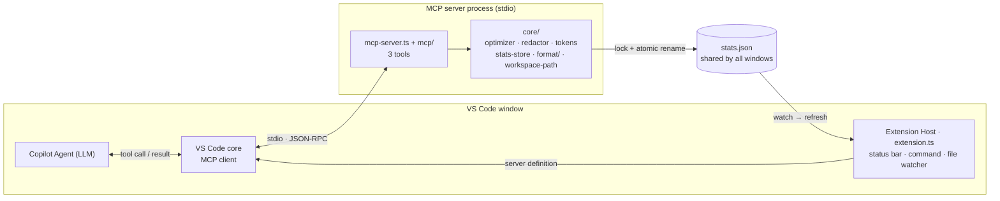
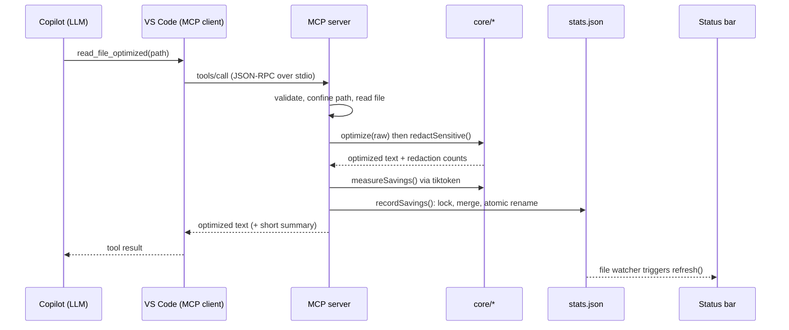
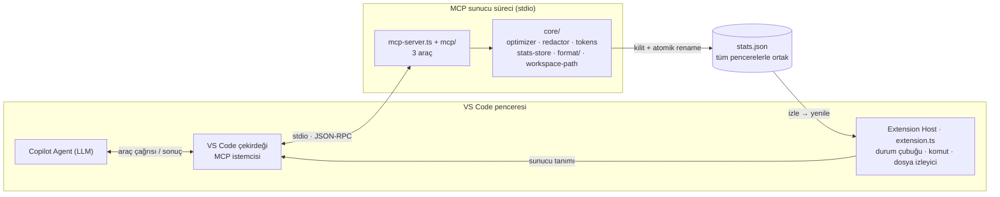
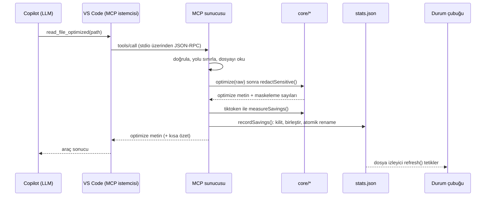

# Visual Guide / Görsel Rehber

**English** · [Türkçe](#türkçe)

## English

A visual, self-contained explanation of how the **AI Token Optimizer** works: the VS Code extension, the MCP server and the optimization engine.

### How to open it

- Open [`index.html`](./index.html) in any browser (macOS: `open visual-guide/index.html`).
- Use the **TR / EN** switch in the top-right corner. Your choice is remembered; `?lang=tr` or `?lang=en` forces a language.
- It is a single file with no dependencies. It works offline and makes no network requests (a Content-Security-Policy enforces this).

### What is inside `index.html`

| # | Section | You will learn |
| - | ------- | -------------- |
| 1 | The idea in 60 seconds | What problem the project solves, with real token numbers |
| 2 | Architecture | The two processes (extension and MCP server) and the one file they share |
| 3 | Life of one tool call | The nine steps from "Copilot reads a file" to "the status bar updates" |
| 4 | Inside the optimizer | The pruning pipeline, with a real before/after run |
| 5 | Redaction | Which secrets, IPs, MACs and e-mails are masked, and in what order |
| 6 | Measuring savings | Payload vs net savings, the "summary tax", the shared `stats.json` |
| 7 | Code map | Layer diagram (which process loads what), a file-by-file table and a reading order |
| 8 | Cheat sheet | Tools, settings, commands and environment variables |

### Quick look (renders on GitHub)

### Good to know

- Every number in the guide was produced by running the real code (v0.0.10, commit `9263736`, plus the CHANGELOG's Unreleased fixes). It is a snapshot: re-measure after changing the optimizer.
- This folder is listed in `.vscodeignore`, so it is not shipped inside the extension package.

---

## Türkçe

**AI Token Optimizer**'ın nasıl çalıştığını görsel olarak anlatan, tek başına çalışan bir rehber: VS Code eklentisi, MCP sunucusu ve optimizasyon motoru.

### Nasıl açılır

- [`index.html`](./index.html) dosyasını herhangi bir tarayıcıda açın (macOS: `open visual-guide/index.html`).
- Sağ üstteki **TR / EN** düğmesini kullanın. Seçiminiz hatırlanır; `?lang=tr` veya `?lang=en` dili zorlar.
- Tek dosyadır, bağımlılığı yoktur. Çevrimdışı çalışır ve ağ isteği yapmaz (bunu bir Content-Security-Policy zorunlu kılar).

### `index.html` içinde neler var

| # | Bölüm | Ne öğrenirsiniz |
| - | ----- | --------------- |
| 1 | Fikir: 60 saniyede | Projenin hangi sorunu çözdüğü, gerçek token sayılarıyla |
| 2 | Mimari | İki süreç (eklenti ve MCP sunucusu) ve paylaştıkları tek dosya |
| 3 | Bir araç çağrısının yaşam döngüsü | "Copilot dosya okur"dan "durum çubuğu güncellenir"e dokuz adım |
| 4 | Optimizer'ın içi | Budama hattı ve gerçek bir öncesi/sonrası çalıştırma |
| 5 | Maskeleme | Hangi sır, IP, MAC ve e-postaların hangi sırayla maskelendiği |
| 6 | Kazancı ölçmek | Payload ve net kazanç, "özet satırı vergisi", ortak `stats.json` |
| 7 | Kod haritası | Katman diyagramı (hangi süreç neyi yükler), dosya dosya tablo ve okuma sırası |
| 8 | Özet kart | Araçlar, ayarlar, komutlar ve ortam değişkenleri |

### Hızlı bakış (GitHub'da görüntülenir)

### Bilmekte fayda var

- Rehberdeki her sayı, gerçek kod çalıştırılarak üretildi (v0.0.10, `9263736` commit'i ve CHANGELOG'daki Unreleased düzeltmeleri). Bir anlık görüntüdür: optimizer değişirse yeniden ölçün.
- Bu klasör `.vscodeignore` içinde listelidir; eklenti paketinin içine girmez.
